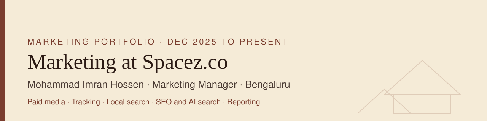
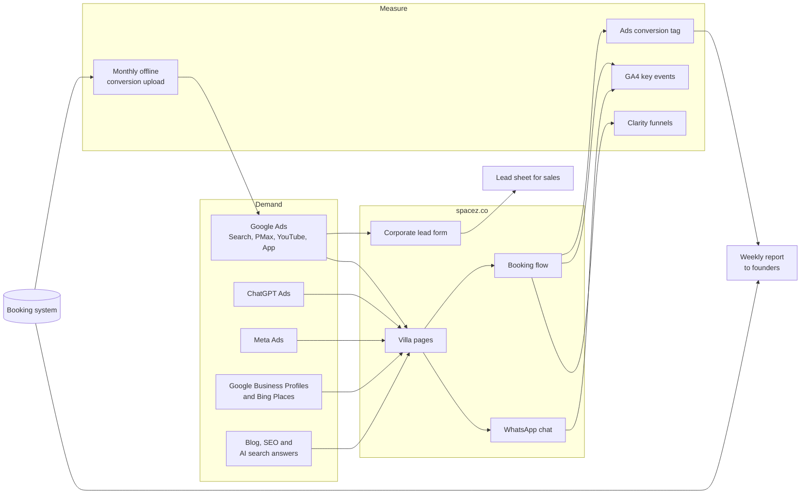

# My first year as Marketing Manager at Spacez.co

I joined Spacez Hospitality and Foods in Bengaluru in December 2025 as Marketing Manager. Spacez rents private luxury villas for stays, parties, team offsites and long stays across Bengaluru, Mumbai and Hyderabad.

I run marketing end to end. That means the ad accounts, the tracking behind them, local search, the blog, AI search visibility and the weekly numbers the founders read every Monday.

This repo is my record of that work: what I built, why, and how. I wrote it so a hiring manager can see how I think and work.

---

## Results at a glance

| 61% | 5.2x to 15.7x | 48% | 8% to 15% |
|:---:|:---:|:---:|:---:|
| Google Ads spend cut ₹9.9L to ₹3.8L a month | ROAS from takeover to Q3 2026 peak | CAC reduction | CTR lift from A/B testing |

- Rebuilt an under-performing Google Ads account. Removed ₹8.6 lakh (44%) of inefficient spend in Q1 2026
- Cut monthly Google Ads spend 61%, from ₹9.9 lakh to ₹3.8 lakh, while ROAS rose from 5.2x to 10.4x by Q2
- Lifted direct booking revenue 30% through 12 Google Ads campaigns, reducing dependence on OTAs
- Improved CTR from 8% to 15% with disciplined A/B testing
- Built a Reddit-supported AEO programme. Within 3 months the brand was recommended in ChatGPT, Gemini and Claude for selected Bengaluru luxury-stay queries
- Built a Claude and MCP optimisation engine and a Google Ads script that filters irrelevant search terms. Saves about 2 to 3 hours a day
- Grew organic bookings from 10 to 20 a month through SEO and AEO: 45 blog posts, 3 Reddit accounts, 56 Google Business Profiles, with new villas added every month

Spend and CAC figures by Q2 2026. ROAS went 5.2x at takeover, 7.3x in Q1, 10.4x in Q2 and peaked at 15.7x in Q3 2026. 15.7x is a peak, not an average. Figures are self-reported. Account IDs, guest data, internal links and team details stay private.

---

## The year in one table

| Area | What I own and built |
|---|---|
| **Paid search** | Rebuilt the Google Ads account: brand, competitor, city, single-property and event campaigns, plus Performance Max for each city |
| **New channels** | Launched Hyderabad, a Google App install campaign, YouTube video ads and ChatGPT Ads. Ran Meta Ads for bookings and hiring |
| **B2B** | Started a corporate lead engine for team offsites and a new "villa as office" product, with leads flowing into a shared sheet automatically |
| **Measurement** | Cleaned up conversion goals, set GA4 key events, built Clarity payment funnels and a monthly offline conversion upload |
| **Local search** | Ran the Google Business Profile programme for the villa portfolio: naming, descriptions, verification and a link audit across 56 profiles |
| **SEO and AI search** | 45 blog posts with schema and llms.txt, Search Console indexing work, and community answers on Quora and Reddit |
| **Reporting and AI ops** | Weekly report for the founders, a quarterly report card, and Google Ads and Meta data piped into Claude for faster analysis |

---

## How the pieces connect

---

## Case studies

Each one follows the same shape: the situation I walked into, what I did, and what I'd tell the next person.

| # | Case study | In short |
|---|---|---|
| 01 | [Rebuilding the Google Ads account](case-studies/01-google-ads-rebuild.md) | From a few broad campaigns to a structure that matches how guests actually search |
| 02 | [Opening new channels and a new city](case-studies/02-new-channels-and-markets.md) | Hyderabad, App installs, YouTube, ChatGPT Ads and Meta |
| 03 | [A corporate B2B lead engine](case-studies/03-corporate-b2b-leads.md) | Lead form campaign, automatic lead sheet, then a second product on the same engine |
| 04 | [Fixing measurement](case-studies/04-measurement-and-tracking.md) | One source of truth per conversion, no double counting, real bookings fed back to bidding |
| 05 | [Local search across a villa portfolio](case-studies/05-local-search-gbp.md) | Google Business Profile standards, verification and a full link audit |
| 06 | [SEO and AI search visibility](case-studies/06-seo-and-ai-search.md) | Blog system, schema, llms.txt, indexing and community answers |
| 07 | [AI-assisted marketing operations](case-studies/07-ai-marketing-ops.md) | Ad platform data inside Claude, with a human signing off every change |
| 08 | [Reporting the founders trust](case-studies/08-reporting.md) | A weekly report with one agreed source per number |

## Playbooks I wrote

Reusable templates I built at Spacez, cleaned of company data.

- [Single Property Ad Group (SPAG) template](playbooks/spag-template.md)
- [Weekly performance report template](playbooks/weekly-report-template.md)
- [Tracking rules I follow](playbooks/tracking-rules.md)
- [Google Business Profile listing standard](playbooks/gbp-listing-standard.md)
- [Blog SEO and schema checklist](playbooks/blog-seo-checklist.md)
- [Negative keyword themes for a villa rental brand](playbooks/negative-keyword-themes.md)

## Code samples

Small tools from this work, with every credential and ID removed.

- [Meta Ads weekly insights puller](code/meta-ads-reporting/) (Python, Meta Marketing API, read-only)
- [Google Ads lead form emails to Google Sheet](code/lead-form-to-sheet/) (Google Apps Script)

---

## Timeline

See [TIMELINE.md](TIMELINE.md) for the month-by-month version.

| When | Milestone |
|---|---|
| Dec 2025 | Joined. Audited the account: search terms, keywords and campaign setup. First shared negative keyword list |
| Jan 2026 | Split brand and competitor search into their own campaigns |
| Feb 2026 | Rebuilt Mumbai search |
| Mar to Apr 2026 | IPL 2026 event ad group, a dedicated campaign for the flagship glass villa, Google Business Profile and blog programme kicked off |
| May 2026 | Hyderabad market research |
| Jun to Sep 2026 | Hyderabad live on Google Ads, App install campaign, ChatGPT Ads, Google Ads connected to Claude, first quarterly report card |
| Sep 2026 | Corporate search campaign with lead forms for team offsites |
| Oct 2026 | Lead sheet automation, GA4 and Clarity clean-up, Search Console indexing work, Meta API reporting, new weekly report format |
| Nov 2026 | "Villa as office" ad group, Google Business Profile link audit, monthly offline conversion upload |

---

## Toolkit

| Area | Tools I used here |
|---|---|
| Ads | Google Ads (Search, Performance Max, YouTube, App, lead forms), Meta Ads Manager, ChatGPT Ads |
| Measurement | GA4, Google Ads conversion tracking, offline conversion imports, Microsoft Clarity, Google Search Console |
| Local | Google Business Profile, Bing Places |
| Content | WordPress, Yoast SEO, WPCode, schema.org JSON-LD |
| Automation and AI | Claude with MCP connectors, Claude in Chrome, Google Apps Script, Python, Meta Marketing API |
| Community | Quora, Reddit |

## How I work

1. **Read the data before touching anything.** Every change starts with the search terms, the conversion setup or the landing page.
2. **One number, one source.** If two tools disagree, I pick the one the business agrees on and write it down.
3. **Facts from the page, not from memory.** Before writing any villa copy I check the live villa page. Wrong amenities cost trust.
4. **AI drafts, I decide.** Claude speeds up the analysis and the busywork. Every live change goes through me.
5. **Ask before you clean up.** Before removing or redirecting anything, check every channel that links to it.

---

Built and maintained by Mohammad Imran Hossen. Spacez and spacez.co belong to Spacez Hospitality and Foods Pvt. Ltd. This is a personal portfolio, not an official company page. Last updated November 2026.
